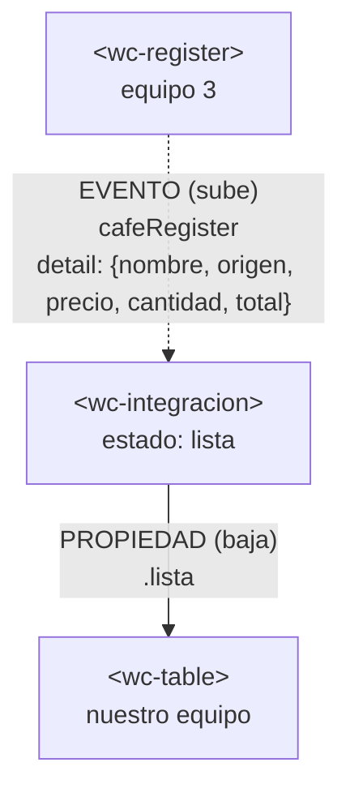
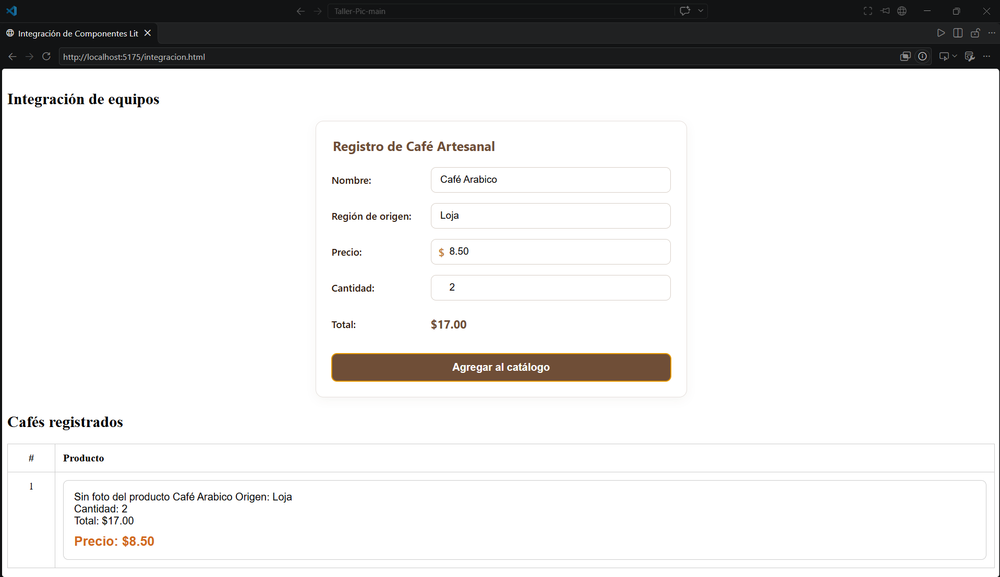

# Integración con el componente de otro equipo

## 1. Datos

| Campo | Valor |
|---|---|
| Equipo | Equipo 4 · Catálogo de productos (Taller-Pic) |
| Equipo externo | Equipo 3 · Café Raíz |
| Repositorio externo | https://github.com/Shairr/Componentes-Lit-G3 |
| Archivo externo | `src/views/home/register.js` → copiado en `src/externos/equipo_externo/register.js` |
| Commit usado | `512c0c9` |

## 2. Componentes y roles

| Componente | Archivo | Origen | Rol |
|---|---|---|---|
| `<wc-integracion>` | `src/views/integracion/integracion.js` | Nuestro equipo | **Padre**. Dueño del estado `lista`. |
| `<wc-register>` | `src/externos/equipo_externo/register.js` | Equipo 3 | **Hijo**. Emite el evento `cafeRegister`. |
| `<wc-table>` | `src/views/home/tabla.js` | Nuestro equipo | **Hijo**. Recibe la lista por la propiedad `.lista`. |

## 3. Flujo de comunicación



**Adaptador.** El formulario externo envía en `event.detail` los campos `nombre`, `origen`, `precio`, `cantidad` y `total`. Nuestra tabla espera productos con `titulo`, `descripcion`, `precio` y `foto` (opcional). El padre convierte cada registro antes de agregarlo a la lista:

```js
agregarCafe(event) {
  const { nombre, origen, precio, cantidad, total } = event.detail;
  const producto = {
    titulo: nombre,
    descripcion: `Origen: ${origen} · Cantidad: ${cantidad} · Total: $${total.toFixed(2)}`,
    precio,
  };
  this.lista = [...this.lista, producto];
}
```

## 4. Dificultades

| # | Integrante | Síntoma | Causa | Solución |
|---|---|---|---|---|
| 1 | Meza Ramirez Jose Armando | No se podia visualizar debido a que no encontraba la ruta | Falta de /../ para el reconocimiento de las rutas | Inclusión de /../ debido a que estaban a nivel diferente los componentes |
| 2 | Tonato Coronel Carlos Sebastian | No se mostraba el register del grupo externo y la tabla de nuestro grupo | Mal escrito las rutas del import | Corrección de las rutas |
| 3 | Torres Patiño Melany Alexandra | - | - | - |
| 4 | Morales Mendoza Anthony Alejandro | - | - | - |

## 5. Evaluación del componente externo

| Aspecto | Nota (0–5) | Evidencia |
|---|---|---|
| API clara | 5 | El componente presenta propiedades identificables para manejar nombre, origen, precio, cantidad y total, facilitando su utilización desde otros componentes. |
| Evento bien construido | 5 | El componente utiliza eventos personalizados para transmitir los datos ingresados hacia el componente padre mediante event.detail. |
| Robustez | 5 | El formulario funciona correctamente durante el registro habitual, contiene correctas validaciones |
| Encapsulamiento | 5 | El componente pudo integrarse en la aplicación sin provocar conflictos visuales ni errores en la ejecución. |
| Reutilización | 5 | Se importó el componente desde src/externos/ y se utilizó sin modificar su código fuente original. |

## 6. Uso de IA

| Herramienta | Quién la usó | Para qué | Qué cambiamos |
|---|---|---|---|
| Gemini | Jose Meza | Explicación de /../ | |
| Claude | Anthony Morales | Llenado previo de .md | |

## 7. Aportes del equipo

Cada integrante hace commits con su propia cuenta de GitHub. Quien no tenga commits propios en el pull request se califica aparte.

| Integrante | Usuario de GitHub | Rol | Qué hizo | Enlace a sus commits |
|---|---|---|---|---|
| Meza Ramirez Jose Armando | @MezaJose12 | 1 · Integración | Creó la rama, fijó el commit `512c0c9`, copió el componente externo y creó `<wc-integracion>` | https://github.com/MezaJose12/Taller-Pic/commits/taller-integracion?author=MezaJose12 |
| Tonato Coronel Carlos Sebastian | @Sebastian1606520 | 2 · Adaptador y pruebas | Creó `integracion.html`, probó la página y tomó la captura `Taller_Equipo_4.png` | |
| Torres Patiño Melany Alexandra | @Mela-2108 | 3 · Revisión externa | Evaluó el componente externo y abrió el issue en el repositorio del equipo 3 | |
| Morales Mendoza Anthony Alejandro | @Anthonley21 | 4 · Documentación | Escribió `integracion.md` y revisó y fusionó el pull request | |

